# ViewBox Panel System — Database Design

> **Day 2 design baseline — FROZEN.** Created during Day 2 of the assessment.
> Do not edit this file after the Day 2 freeze. Corrections and additions belong in
> `design/v2/` with a note describing what changed and why.

PostgreSQL 15+ (18 recommended). SQLAlchemy 2.x models are the source of truth;
Alembic generates and applies all migrations. Timestamps are timezone-aware UTC.

## Entity relationship diagram

```mermaid
erDiagram
    users ||--o| members : "user owns one member profile"
    users ||--o{ source_links : "created_by"
    users ||--o{ import_jobs : "created_by"
    users ||--o{ payout_ledger : "approved_by"

    sources ||--o{ members : "primary acquisition source (last touch)"
    sources ||--o{ source_links : "tracked signup links"
    sources ||--o{ attribution_history : "attribution touch"

    members ||--o{ members : "referred_by_member_id (self FK)"
    members ||--o| referral_links : "personal REF token"
    members ||--o{ referrals : "as referrer"
    members ||--o| referrals : "as referred member"
    members ||--o{ survey_applications : "applies"
    members ||--o{ survey_completions : "completes"
    members ||--o{ attribution_history : "all touches"
    members ||--o{ meta_leads : "lead converted to member"
    members ||--o{ fraud_flags : "flagged record"
    members ||--o{ payout_ledger : "earns"

    surveys ||--o{ survey_rules : "rules"
    surveys ||--o{ survey_applications : "applications"
    surveys ||--o{ survey_completions : "completions"

    survey_applications ||--o| survey_completions : "approved application may complete"

    import_jobs ||--o{ import_row_errors : "errors"
    import_jobs ||--o{ import_staged_rows : "preview rows"

    users {
        bigint id PK
        string phone UK "normalized 10-digit"
        enum role "MEMBER|OPERATIONS|ADMIN"
        boolean is_active
        timestamptz created_at
        timestamptz updated_at
    }

    otp_challenges {
        bigint id PK
        string phone
        string otp "mock: 123456"
        timestamptz expires_at
        timestamptz verified_at
        timestamptz created_at
    }

    members {
        bigint id PK
        string member_code UK "VB..."
        bigint user_id FK "nullable for imported rows"
        string name
        string email
        date date_of_birth
        string gender "MALE|FEMALE|OTHER"
        string city
        string income_range
        jsonb interests "array of canonical tokens"
        bigint source_id FK "nullable - dynamic source"
        bigint first_touch_source_id FK "retained first touch"
        bigint referred_by_member_id FK "self reference, nullable"
        timestamptz joined_at
        timestamptz last_survey_completed_at
        string registration_ip
        string registration_device_hash
        timestamptz created_at
        timestamptz updated_at
    }

    sources {
        bigint id PK
        string name UK "dynamically managed"
        string source_type
        string description
        boolean is_active
        timestamptz created_at
    }

    source_links {
        bigint id PK
        string token UK "SRC-..."
        bigint source_id FK
        bigint created_by FK
        string campaign_name
        boolean is_active
        timestamptz created_at
    }

    referral_links {
        bigint id PK
        string token UK "REF-..."
        bigint member_id FK,UK
        boolean is_active
        timestamptz created_at
    }

    attribution_history {
        bigint id PK
        bigint member_id FK
        bigint source_id FK "nullable"
        string token
        string attribution_type "SOURCE_LINK|REFERRAL_LINK|QUESTIONNAIRE|META_LEAD|IMPORT"
        string touch "FIRST|LAST"
        jsonb raw_value
        timestamptz occurred_at
    }

    surveys {
        bigint id PK
        string title
        string description
        date start_date
        date deadline
        integer quota
        numeric reward_amount
        string status "DRAFT|LIVE|CLOSED"
        timestamptz created_at
        timestamptz updated_at
    }

    survey_rules {
        bigint id PK
        bigint survey_id FK
        string field_name "age|city|gender|income_range|interests"
        string operator "EQ|IN|GTE|LTE|CONTAINS"
        string expected_value
        string rule_type "STRICT|FLEXIBLE"
        timestamptz created_at
    }

    survey_applications {
        bigint id PK
        bigint survey_id FK
        bigint member_id FK
        enum eligibility_status "APPROVED|WAITLISTED|REJECTED"
        text reason
        jsonb rule_results
        timestamptz applied_at
        timestamptz updated_at
    }

    survey_completions {
        bigint id PK
        bigint survey_id FK
        bigint member_id FK
        timestamptz completed_at
        string quality_status "PENDING|PASSED|FAILED"
        numeric reward_amount
        timestamptz created_at
    }

    referrals {
        bigint id PK
        bigint referrer_member_id FK
        bigint referred_member_id FK,UK
        string status "LEAD|FIT|COMPLETED|FAILED"
        string failure_reason
        timestamptz created_at
        timestamptz updated_at
    }

    meta_leads {
        bigint id PK
        string meta_lead_id UK
        string form_id
        string page_id
        string campaign_id
        string adgroup_id
        string ad_id
        timestamptz lead_created_at
        jsonb raw_payload
        string processing_status "PROCESSED|FLAGGED|REJECTED"
        bigint member_id FK "nullable"
        string failure_reason
        timestamptz created_at
    }

    import_jobs {
        bigint id PK
        string filename
        string file_hash UK "SHA-256 idempotency"
        integer total_rows
        integer imported_rows
        integer skipped_rows
        integer corrected_rows
        integer error_rows
        bigint created_by FK
        timestamptz created_at
    }

    import_staged_rows {
        bigint id PK
        bigint import_job_id FK
        integer row_number
        jsonb original_data
        jsonb normalized_data
        jsonb corrections
        jsonb errors
        string action "IMPORT|SKIP|REVIEW"
        timestamptz created_at
    }

    import_row_errors {
        bigint id PK
        bigint import_job_id FK
        integer row_number
        jsonb original_data "untouched original values"
        string error_code
        text error_message
        string action_taken
        timestamptz created_at
    }

    fraud_flags {
        bigint id PK
        bigint member_id FK "nullable"
        string flag_type
        string severity
        jsonb details
        string status "OPEN|REVIEWED|DISMISSED"
        timestamptz created_at
    }

    payout_ledger {
        bigint id PK
        bigint member_id FK
        string source_type "SURVEY|REFERRAL"
        bigint reference_id
        numeric amount
        string status "PENDING|APPROVED|PAID|FAILED"
        bigint approved_by FK
        timestamptz paid_at
        timestamptz created_at
        timestamptz updated_at
    }
```

## Relationship notes

1. **users → members (1:1 optional).** A login identity may exist before a profile is
   completed. Imported rows have `user_id = NULL` (no invented phone login).
2. **sources → members (1:N).** One acquisition source per member, stored as a FK —
   source names are never hardcoded enums. `first_touch_source_id` is a second FK to the
   same table, preserving first touch while `source_id` is last touch.
3. **members → members (self FK).** Referrer is a separate concept from acquisition
   source. `referred_by_member_id` points to another member; a CHECK constraint blocks
   self-referral at the row level.
4. **referral_links (1:1 per member).** Tokens use `REF-` prefix; source links use `SRC-`.
   Two distinct tables guarantee no token collision between attribution types.
5. **surveys → survey_rules / survey_applications / survey_completions (1:N).**
   `survey_applications` has a UNIQUE `(survey_id, member_id)` constraint to prevent
   duplicate applications. `survey_completions` likewise has UNIQUE `(survey_id, member_id)`.
   An approved application may have at most one matching completion.
6. **referrals.referred_member_id is UNIQUE** — one referral relationship per new member.
7. **import_jobs → import_staged_rows / import_row_errors (1:N).** Staged rows power the
   preview-before-confirm workflow; row errors retain the untouched original JSON.
8. **meta_leads.meta_lead_id is UNIQUE** — idempotent webhook processing.
9. **fraud_flags and payout_ledger** are additive (bonus) tables; described below.

## Justification for tables beyond the 12 specified

| Table | Why it is necessary |
|---|---|
| `referral_links` | Spec requires personal member referral tokens distinct from source-link tokens; separate table enforces separate namespaces. |
| `attribution_history` | Spec asks for last-touch primary attribution with first-touch retained when practical; this table records every touch, First and Last. |
| `otp_challenges` | Mock OTP needs expiry/verification state; avoids storing OTP state in memory. |
| `import_staged_rows` | Spec requires *preview before confirm*; staged rows persist the analysis between the two API calls. |
| `fraud_flags` | Spec requires suspicious records to be flagged, never deleted; audit trail for duplicates and referral abuse. |
| `payout_ledger` | Bonus payout workflow requires approval states and an audit trail. |

## Constraints, indexes and data rules

* `members.member_code`, `users.phone`, `sources.name`, `source_links.token`,
  `referral_links.token`, `meta_leads.meta_lead_id`, `import_jobs.file_hash` — UNIQUE.
* `referrals`: `CHECK (referrer_member_id <> referred_member_id)`.
* Phone normalization: strip all non-digits, drop leading `91`/`0`; store the canonical
  10-digit value in `users.phone` and `meta_leads` payload. Duplicate detection uses this
  normalized value; duplicates become `fraud_flags`, not hard insert failures.
* Indexes: `members(name)`, `members(city)`, `members(source_id)`,
  `members(joined_at)`, `members(referred_by_member_id)`,
  `survey_applications(survey_id, eligibility_status)`,
  `survey_completions(member_id, completed_at)`,
  `referrals(referrer_member_id, status)`, `attribution_history(member_id, occurred_at)`,
  `meta_leads(processing_status)`.
* Money: `NUMERIC(12,2)`, never float.
* Eligibility reason strings are generated in the service layer and stored in
  `survey_applications.reason`; UI never invents reasons.
* Cooling off: `last_survey_completed_at + 3 calendar months` computed from the most
  recent PASSED completion, using calendar-month arithmetic (not 90 days).
* Quota: approvals counted with a locked survey row (`FOR UPDATE`) to prevent races;
  a slot is consumed on APPROVED.
