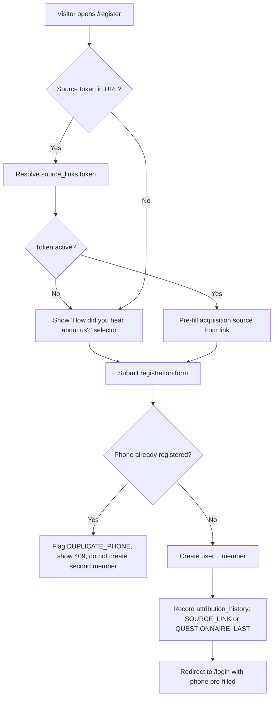
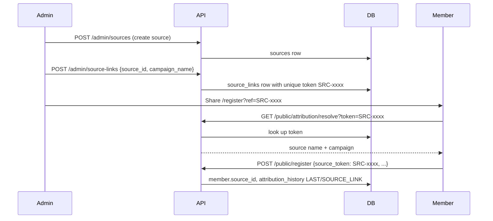
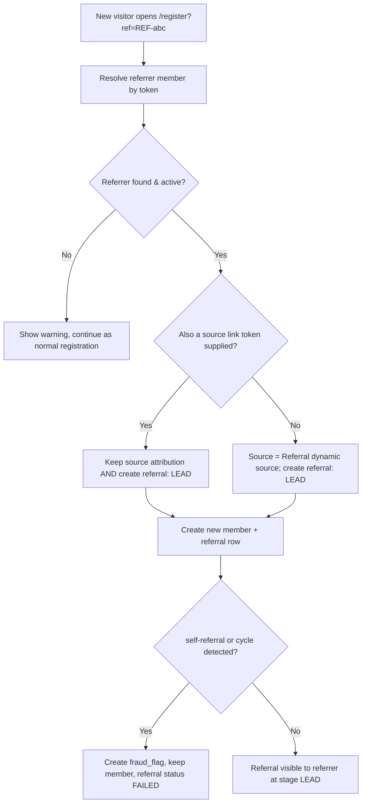
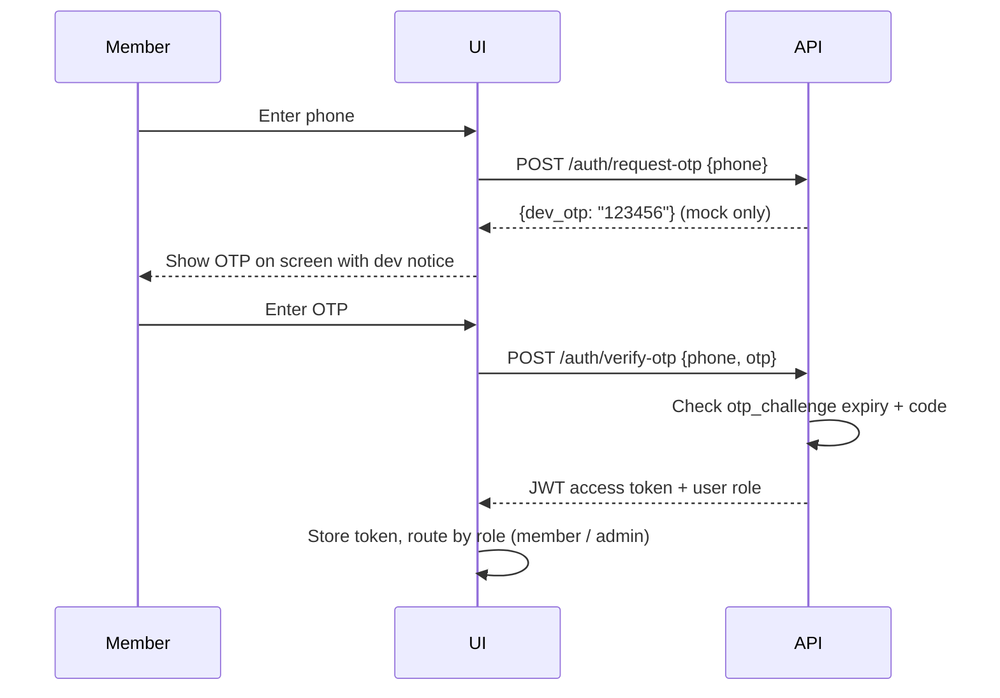
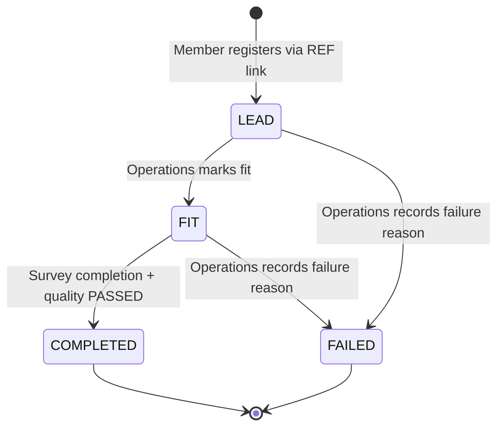
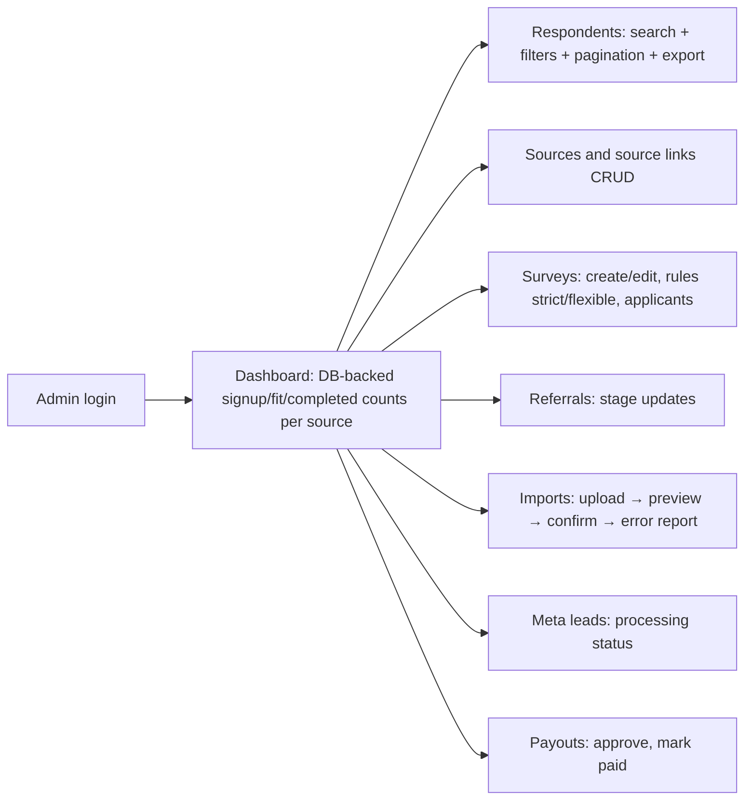
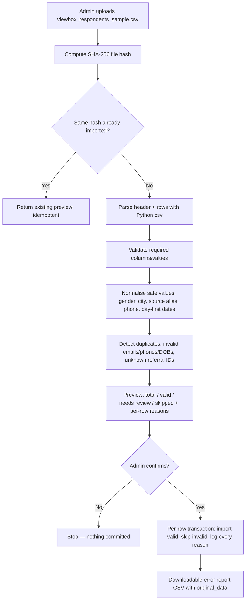
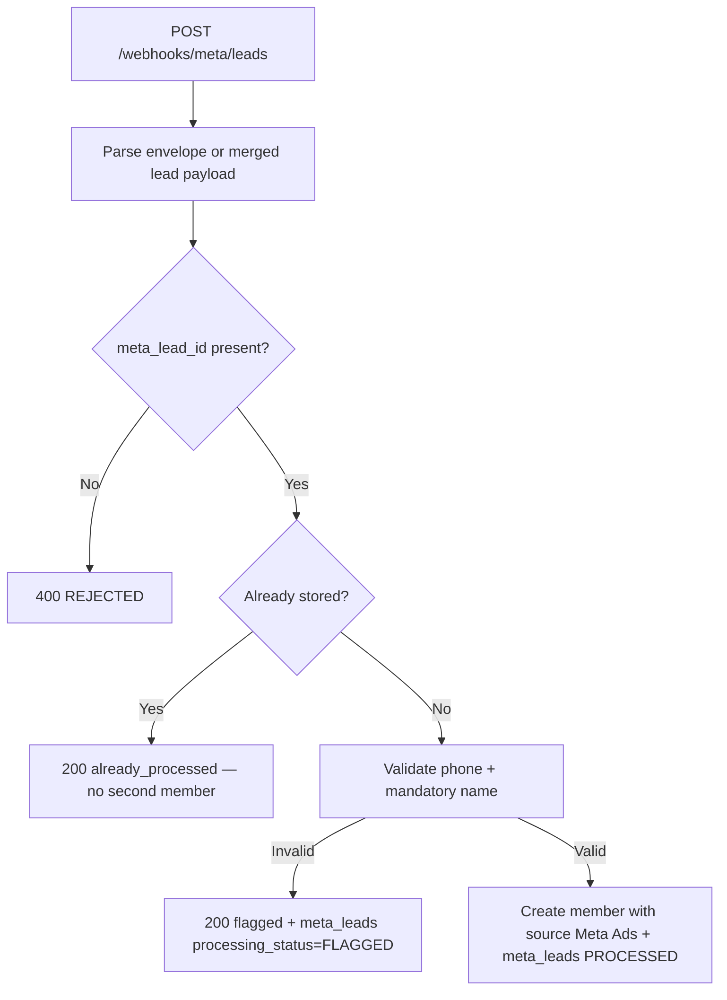

# ViewBox Panel System — User Flows

> **Day 2 design baseline — FROZEN.** Created during Day 2 of the assessment.
> Do not edit this file after the Day 2 freeze. Corrections and additions belong in
> `design/v2/` with a note describing what changed and why.

## Overview

The system has three actor types:

| Actor | Description | Key capabilities |
|---|---|---|
| **Prospective member** | Consumer recruited from WhatsApp, Instagram, Facebook, website, staff DM, referral or Meta Ads | Register through a tracked link, complete profile |
| **Member (respondent)** | Verified panel member | OTP login, profile, survey discovery, eligibility, referral progress, payout view |
| **Operations / Admin** | Concave Insights staff | Manage sources, links, surveys, rules, respondents, referrals, imports, exports, payouts |

Authentication is phone-number based with a **mocked OTP**. The fixed development OTP is
`123456`; it is displayed on the login screen and returned by the request-OTP endpoint in
development mode. No SMS provider is integrated.

---

## Flow 1 — Member registration (direct / website)



Registration required fields: name, phone, date of birth, gender, city, income range.
Email and interests are optional. Nothing is invented: blank optional values stay null.

## Flow 2 — Source tracking



* A source is a dynamically managed row, never a hardcoded enum.
* Source links have `SRC-` prefixed tokens; referral links have `REF-` prefixed tokens.
  They are separate tables and separate namespaces.
* **Last touch wins** for `members.source_id`. All touches are retained in
  `attribution_history`, so first touch is preserved for reporting.

## Flow 3 — Referral registration and source/referral conflict



**Source conflict rule:** acquisition source and referral relationship are independent.
An Instagram source link plus a member referral code credits **both** — Instagram stays
as `members.source_id`, and the referral row links referrer → referred member. One never
overwrites the other.

**Source alias mapping** during import (original value preserved in `import_row_errors`):

| Raw values | Canonical source |
|---|---|
| `Instagram`, `insta`, `IG` | Instagram |
| `Facebook`, `FB` | Facebook |
| `Website`, `website` | Website |
| `Referral` | Referral |
| `WhatsApp Group - Mumbai`, `whatsapp mumbai`, `WA grp mumbai` | WhatsApp Group - Mumbai |
| `WhatsApp Group - Pune` | WhatsApp Group - Pune |
| `Staff DM - Agent 01`, `Staff DM - Agent 02` | unchanged (distinct staff sources) |
| `5 lakh` income, unknown sources, blank sources | flagged, never auto-assigned |

## Flow 4 — OTP login



Role checks are enforced on every protected endpoint (`MEMBER`, `OPERATIONS`, `ADMIN`).
A member token cannot call admin routes; the API returns 403.

## Flow 5 — Profile completion

```mermaid
flowchart TD
    A[Member logs in] --> B{Profile complete?}
    B -- No --> C[Redirect to /member/profile with completion banner]
    B -- Yes --> D[Member dashboard]
    C --> E[PUT /members/me {name,dob,gender,city,income_range,interests}]
    E --> F[Revalidate eligibility for all live surveys]
    F --> D
```

## Flow 6 — Survey discovery, eligibility and completion

```mermaid
flowchart TD
    A[Member home] --> B[GET /surveys/live]
    B --> C[For each survey: evaluate eligibility engine]
    C --> D{Result}
    D -- APPROVED --> E[Show 'You can participate' + Apply/Check-in]
    D -- WAITLISTED --> F[Show flexible-rule misses in plain language]
    D -- REJECTED --> G[Show reason, e.g. cool-off date or quota reached]
    E --> H[POST /surveys/{id}/applications]
    H --> I[Survey completion recorded by operations: quality PASSED]
    I --> J[Create payout ledger entry PENDING]
    J --> K[Cool-off starts from latest qualifying completion date]
```

Eligibility evaluation order (deterministic, one reason string per result):

1. Survey deadline passed → REJECTED
2. Any STRICT rule fails → REJECTED (all strict failures listed)
3. 3-month calendar cool-off active → REJECTED with `Eligible again on DD-MM-YYYY`
4. Quota reached (approved applications >= quota, survey row locked) → REJECTED
5. Any FLEXIBLE rule fails → WAITLISTED (list flexible misses)
6. Otherwise → APPROVED

Results are persisted in `survey_applications` (unique per survey + member) and
recalculated when a profile or survey rule changes.

**Quota assumption:** a slot is consumed when an application becomes APPROVED.
WAITLISTED and REJECTED do not consume quota. Concurrent approvals are serialised with
`SELECT ... FOR UPDATE` on the survey row.

## Flow 7 — Referral tracking



The referrer dashboard shows referred person's **name**, masked phone
(e.g. `+91 9•••• ••943`), current stage and failure reason. No other private profile
data is exposed. Only `OPERATIONS`/`ADMIN` can change stages; `COMPLETED` is refused
unless a PASSED survey completion exists for the referred member.

## Flow 8 — Admin operations



* Respondent search: name, member code, city; filters: source, city, status; server-side
  pagination; loading, empty and error states.
* Export (CSV and XLSX) uses **the current search/filter parameters**, not all rows.
* All list numbers come from SQL aggregations — no hardcoded dashboard values.

## Flow 9 — CSV import (messy file)



* Corrections are logged with both original and normalized values.
* Ambiguous dates are parsed **day-first** with a `26` century pivot and flagged as
  `AMBIGUOUS_DATE` — never silently accepted without a warning.
* Duplicates, self-referrals and unknown referrer IDs become `fraud_flags`; no row is
  physically deleted and no personal data is invented.
* Unknown sources are imported with `source_id = NULL` and an error entry, never mapped
  to a guessed source. `5 lakh` income is flagged as `UNKNOWN_INCOME`.

## Flow 10 — Meta lead webhook



Per official Meta documentation, the live webhook notification carries IDs only
(`leadgen_id`, `page_id`, `form_id`, `adgroup_id`/`ad_id`, `created_time`) and field data
(`full_name`, phone, city) is fetched from `GET /{lead_id}` as `field_data`.
The mock endpoint accepts a merged representation of both and documents this explicitly.
